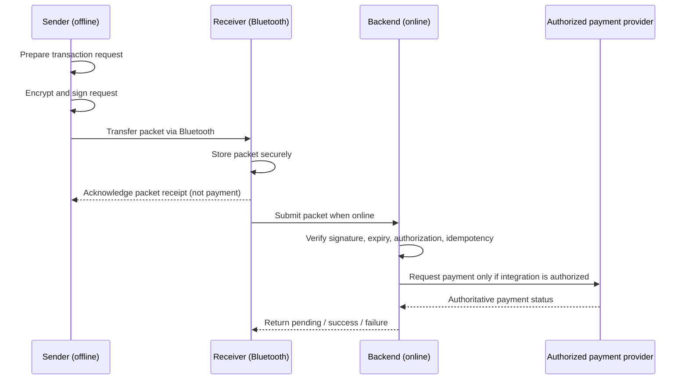

# UPI Without Internet

> **Status:** Project concept / prototype documentation. Implementation details and integrations should be updated to reflect the actual codebase.

A proposed **offline payment-instruction transfer system** that uses Bluetooth to move a protected transaction request from a sender's smartphone to a receiver's smartphone. The receiver can submit the request to a backend when internet connectivity becomes available.

**Important:** This is not an official UPI implementation or a claim of NPCI/bank integration. Transferring a request over Bluetooth **does not mean money has been transferred**. A real payment is successful only after confirmation from authorized payment infrastructure.

## Problem statement

When a sender has no mobile data or Wi-Fi, a conventional online payment request cannot be submitted directly from their device. This project explores how a sender could prepare an authenticated transaction instruction offline, send it to another nearby device over Bluetooth, and have it submitted later for server-side validation.

## Proposed workflow



## Architecture

```text
Sender Android App (offline)
  ├─ Transaction creation
  ├─ Cryptography / signing
  ├─ Bluetooth transport
  └─ Local pending state
               │
               │ Encrypted, signed packet
               ▼
Receiver Android App
  ├─ Bluetooth transport
  ├─ Secure local packet storage
  └─ Internet-based submission / retries
               │
               │ HTTPS
               ▼
Backend API (proposed: Java + Spring Boot)
  ├─ Authentication and device registration
  ├─ Signature and payload verification
  ├─ Expiration and replay protection
  ├─ Idempotent transaction processing
  ├─ Database and audit records
  └─ Payment-provider adapter (mock for prototype)
               │
               ▼
Mock payment processor / authorized integration
```

## Main design elements

| Component | Purpose | Notes |
| --- | --- | --- |
| Bluetooth | Transfer packet without sender internet | Device discovery, connection, chunking and acknowledgement needed |
| AES-256-GCM | Authenticated payload encryption | Unique nonce per encryption under the same key |
| RSA-OAEP | Optional encryption of AES key | Use a trusted recipient public key |
| RSA-PSS | Optional transaction signing | Sign canonical transaction fields; protect private keys |
| SHA-256 | Hash / request fingerprint | A plain hash does not prove sender identity |
| Idempotency | Prevent repeated processing of the same request | Enforce uniqueness atomically on backend and reconcile provider outcomes |
| TTL | Reject stale transaction instructions | Enforce using trusted backend time; offline clock handling needs design |
| Secure storage | Preserve packets across disconnections | Protect local sensitive data and define retention |

**Security note:** Cryptography is only one layer. The system also needs trustworthy device enrollment, transaction authorization, secure key management, receiver authentication where applicable, and server-side validation. A receiver must not be able to alter the signed recipient or amount.

## Illustrative transaction envelope

The following is a **schema example, not a finalized protocol or real payment payload**:

```json
{
  "protocolVersion": 1,
  "transactionId": "a9b2f88d-8b5a-4d6d-bdf1-3a87f39bfc71",
  "senderId": "sender-123",
  "receiverId": "receiver-456",
  "createdAt": "2026-11-11T12:00:00Z",
  "expiresAt": "2026-11-11T12:05:00Z",
  "encryptionAlgorithm": "AES-256-GCM",
  "keyWrapAlgorithm": "RSA-OAEP",
  "signatureAlgorithm": "RSA-PSS",
  "nonce": "BASE64_NONCE",
  "encryptedKey": "BASE64_WRAPPED_KEY",
  "ciphertext": "BASE64_CIPHERTEXT_AND_TAG",
  "signature": "BASE64_SIGNATURE"
}
```

The encrypted and signed transaction data should include the amount (preferably integer minor units), currency, sender, recipient, unique transaction ID, expiration, and protocol version. Define a canonical serialization and bind authenticated metadata to the ciphertext. Never store secrets or private keys in the repository.

## Transaction lifecycle

```text
CREATED → ENCRYPTED → TRANSFERRED → RECEIVED → SUBMITTED
                                              │
                                              ▼
                                          VALIDATING
                                              │
                            ┌─────────────────┴─────────────────┐
                            ▼                                   ▼
                         REJECTED                           PROCESSING
                                                                │
                                                 ┌──────────────┼──────────────┐
                                                 ▼              ▼              ▼
                                              SUCCESS         FAILED         PENDING
                                                                               │
                                                                               ▼
                                                                           RECONCILE
```

**Never treat `TRANSFERRED`, `RECEIVED`, or `SUBMITTED` as a successful payment.** Unknown provider outcomes should remain pending until reconciled.

## Suggested technology stack

This is a recommended stack, **not a verified list of implemented technologies**:

- **Mobile:** Android (Java or Kotlin), Android Bluetooth APIs, Room/SQLite
- **Backend:** Java, Spring Boot, REST APIs
- **Database:** PostgreSQL
- **Security:** Java Cryptography Architecture, AES-GCM, RSA-OAEP, RSA-PSS, Android Keystore
- **Testing:** JUnit, Mockito, Postman, Android device tests
- **Build and tooling:** Gradle for Android, Maven/Gradle for backend, Git, Docker (optional)

## Suggested repository structure

```text
upi-without-internet/
├── README.md
├── mobile-app/                 # Android app source (when added)
│   ├── sender/
│   ├── receiver/
│   ├── bluetooth/
│   ├── crypto/
│   └── storage/
├── backend/                    # Backend service (when added)
│   ├── src/
│   └── pom.xml
├── database/
│   └── migrations/
├── docs/
│   ├── architecture.md
│   ├── protocol.md
│   ├── threat-model.md
│   └── api.md
└── tests/
```

This is a proposed structure; adapt it to your actual repository rather than creating empty directories only for appearance.

## Proposed REST API

| Method | Endpoint | Purpose |
| --- | --- | --- |
| `POST` | `/api/v1/devices/register` | Register device and public key |
| `POST` | `/api/v1/transactions` | Submit a signed encrypted request |
| `GET` | `/api/v1/transactions/{id}` | Retrieve transaction state |
| `POST` | `/api/v1/transactions/{id}/acknowledge` | Record application-level receipt |

All endpoints above are **proposed**, not confirmed to exist. Use authenticated HTTPS requests and appropriate authorization. A JWT alone is not proof of offline transaction consent.

## Important limitations and open problems

### Double spending

A sender with ₹1,000 could create two different offline requests for ₹800. Both might have valid signatures, unique IDs and unexpired TTLs. Idempotency does **not** solve this. Possible designs include a trusted pre-authorized spending allowance or a deferred request that is allowed to fail when the bank checks funds. A real offline wallet needs secure anti-rollback controls and authorized issuer integration.

### Trust and authorization

The sender's offline signature must be bound to an enrolled device/account and a legitimate authorization flow. The backend must verify that the sender actually authorized the specific amount and recipient; signatures alone do not establish that the signer may debit a bank account.

### Connectivity and finality

If the receiver never connects to the internet, the packet may never be submitted. If the provider response is lost, the backend must reconcile rather than blindly retry the debit. The sender and receiver need clear `PENDING`, `FAILED`, and `SUCCESS` states.

### Real-world payment integration

Actual UPI execution requires approved access to the payment ecosystem and compliance with applicable NPCI, RBI and payment-provider rules. Use a **mock payment processor** for demonstrations until an authorized integration exists. Do not collect or store real UPI PINs in a prototype.

## Testing checklist

- [ ] Valid Bluetooth packet transfer
- [ ] Connection interrupted during transfer
- [ ] Sender or receiver application restarts
- [ ] Invalid AES-GCM authentication tag rejected
- [ ] Invalid signature rejected
- [ ] Changed recipient or amount rejected
- [ ] Expired packet rejected
- [ ] Duplicate transaction submitted concurrently
- [ ] Same idempotency key with different payload rejected
- [ ] Receiver offline and later retrying
- [ ] Payment processor timeout and reconciliation
- [ ] Two distinct offline transactions exceeding available funds
- [ ] Lost or revoked device key
- [ ] Transaction status shown correctly as pending versus successful

## Development roadmap

1. **Prototype transport:** Android sender/receiver discovery, Bluetooth transfer, acknowledgements.
2. **Protect messages:** Canonical packet format, authenticated encryption, signing, key enrollment.
3. **Backend:** Device validation, API authentication, durable transaction state, database uniqueness.
4. **Reliability:** Retry handling, TTL, replay prevention, reconciliation and audit trail.
5. **Mock payments:** Simulated balances and deterministic success/failure/pending outcomes.
6. **Security evaluation:** Double-spend attempts, tampering, compromised devices and threat-model review.
7. **Authorized integration research:** Assess feasibility and applicable regulatory requirements before any real payment processing.

## What is implemented

| Module | Contents |
| --- | --- |
| `protocol/` | Plain Java 17 library, no dependencies. `PaymentInstruction` (canonical signed fields), `Envelope` (the packet), `EnvelopeCrypto` (seal/open). Meant to be shared by the Android apps and the backend. |
| `backend/` | Spring Boot 4 service: user accounts and login, device enrolment with proof of key possession, device revoke, packet verification, expiry/TTL checks, idempotency, a mock ledger with per-user balances and a double-spend guard, transaction history, and error codes. H2 in memory by default, PostgreSQL via env vars. The backend key is created once and kept in `data/backend-key.der` (override with `UPI_KEY_FILE`). |
| Web dashboard | Served by the backend at http://localhost:8081/. Log in to see your mock balance and transaction history, and to revoke a lost phone. Plain HTML/JS, no build step. |
| `android/` | One Kotlin app for both roles; it compiles the `protocol/` sources directly. Login, signing key in Android Keystore, Bluetooth RFCOMM to paired phones, packets saved as files in app-private storage. Both the receiver and the sender can submit a packet. Resubmitting is safe, and it is how the sender learns the final outcome. |

Not built yet: the `/acknowledge` endpoint, a PENDING/reconcile path (the mock processor always answers right away), notifications, and token refresh.

### Real UPI money in and out (Razorpay)

There's no public "UPI API": only NPCI-approved banks and payment companies reach UPI. UPI also can't debit someone who is offline. So this works like NPCI's own offline product, UPI Lite:
1. **Top up (online):** the user pays a Razorpay payment link with any UPI app. The wallet is credited only after Razorpay confirms it, through a signed webhook or a **Check status** call. It is credited once, however often it is confirmed.
2. **Pay (offline):** Bluetooth or mesh, as above, from the wallet balance.
3. **Withdraw (online):** a RazorpayX payout to the user's UPI ID. The wallet is debited first, so the money can't also be spent offline. If Razorpay definitely rejects it, the money is refunded. If the outcome is unknown (a timeout), it stays `PENDING` and **Check status** retries with the same idempotency key, so it is never paid twice.

Setup (test mode, free):
1. Create a Razorpay account. In test mode, copy the key id (`rzp_test_...`) and secret.
2. For withdrawals, enable RazorpayX and copy its test account number.
3. Before starting the backend, set these in your terminal. Don't put them in any file in this repo.
   ```bash
   export RAZORPAY_KEY_ID=rzp_test_xxx RAZORPAY_KEY_SECRET=xxx RAZORPAYX_ACCOUNT_NUMBER=xxx
   ```
4. Optional: a webhook. Point Razorpay at `https://<public-url>/api/v1/webhooks/razorpay` with the events `payment_link.paid`, `payout.processed`, `payout.failed` and `payout.reversed`, and set `RAZORPAY_WEBHOOK_SECRET`. Locally, use **Check status** instead, because Razorpay can't reach localhost.

Without keys, everything else works, and the wallet endpoints return `503 PAYMENT_SERVICE_UNAVAILABLE`. When using real top-ups, set `upi.mock.starting-balance-minor=0` so accounts don't start with demo money.

| Method | Endpoint | Result |
| --- | --- | --- |
| `GET` | `/wallet` | Balance, top-ups, withdrawals |
| `POST` | `/wallet/topups` | `{amountMinor}` (₹1–₹1,00,000) → `{topupId, paymentUrl, status: PENDING}` |
| `POST` | `/wallet/topups/{id}/refresh` | Asks Razorpay; credits once if paid |
| `POST` | `/wallet/withdrawals` | `{amountMinor, vpa}` → `PAID`, `FAILED` (refunded) or `PENDING` (unknown, check again) |
| `POST` | `/wallet/withdrawals/{id}/refresh` | Reconciles a `PENDING` withdrawal |
| `POST` | `/webhooks/razorpay` | Razorpay only; ignored unless the `X-Razorpay-Signature` HMAC matches |

### Mesh mode (deferred settlement through strangers)

A payment doesn't have to reach the receiver directly. Any phone can carry the sealed packet and pass it to others over Bluetooth, and whichever phone gets internet first (a "bridge") uploads it. This is safe for three reasons:
- **Carriers can't read the packet.** It's encrypted to the backend.
- **Carriers can't change it.** The sender's signature covers the amount and receiver, and the ids are bound by AES-GCM.
- **Delivering it twice charges nothing extra.** The second delivery settles nothing.

A relay is only told "delivered", never the amount or outcome. This is still an IOU until the backend settles it: the sender may not have the funds by then.

- **Simulator:** log in on the dashboard and open http://localhost:8081/mesh.html. It creates a virtual sender phone with a key generated in the browser, then seals and signs a payment in the same format the Android app uses. You then run gossip rounds across six simulated phones, and let two bridges upload at the same moment. The phones are simulated; the crypto and backend are real.
- **Android:** a receiving phone keeps packets addressed to someone else (shown as `CARRY`). **Forward carried packets** passes them to another paired phone, and **Upload carried packets** delivers them when online.

Modelled on [perryvegehan/UPI_Without_Internet](https://github.com/perryvegehan/UPI_Without_Internet). Unlike that demo, packets here are signed by the sender, so a carrier or anyone holding the backend's public key can't create payments. Duplicates are caught by the signed transaction id in the database, not by an in-memory hash of the encrypted bytes.

To fill the dashboard with demo data, start the backend and run `java -cp protocol/target/classes scripts/SeedDemo.java` from the repo root.

### Trying the Android app

1. Start the backend on a laptop (see below) and note its LAN IP address.
2. Install the app on two phones and pair them in the system Bluetooth settings.
3. On each phone, enter `http://<laptop-ip>:8081`, a username, a password and a device ID, then tap **Log in and register this phone** (needs internet). New usernames get an account with a ₹1000 mock balance.
4. Turn off the sender's data. On the receiver, tap **Start receiving**. On the sender, enter the receiver's ID and an amount, pick the receiver's phone, and tap **Send**. Both phones show the request as *not paid yet*.
5. Once either phone is back online, tap **Submit received** (receiver) or **Sync sent** (sender) to get `SUCCESS` or `FAILED`.

Build it with `cd android && ./gradlew assembleDebug`. This needs the Android SDK: set `sdk.dir` in `android/local.properties` or `ANDROID_HOME`. The APK lands in `android/app/build/outputs/apk/debug/`.

**Packet format (v1).** It differs from the illustrative envelope above in two ways. The signature sits *inside* the ciphertext, because an outer signature over small amounts would let anyone with the sender's public key guess the amount. Algorithms are fixed by `protocolVersion` and are not separate fields. Visible fields: `protocolVersion, transactionId, senderId, receiverId, nonce, encryptedKey, ciphertext`. The three ids are AES-GCM associated data, so a receiver who changes any of them makes decryption fail.

## Running the project

Requires Java 21+ and Maven.

```bash
mvn install          # builds both modules and runs all tests
mvn -pl backend spring-boot:run   # API on http://localhost:8081
```

For PostgreSQL instead of in-memory H2, set `SPRING_DATASOURCE_URL`, `SPRING_DATASOURCE_USERNAME` and `SPRING_DATASOURCE_PASSWORD` before starting. The schema is created from `backend/src/main/resources/schema.sql`.

API (all under `/api/v1`). Every endpoint except the first three needs `Authorization: Bearer <token>`:

| Method | Endpoint | Result |
| --- | --- | --- |
| `POST` | `/auth/register` | `{username, password}` (password 8–72 chars). Creates an account with a ₹1000 mock balance. |
| `POST` | `/auth/login` | `{username, password}` → `{token, expiresAt}`. Tokens last 30 days. |
| `GET` | `/keys/backend` | Backend public key. The sender caches it while online. |
| `POST` | `/auth/logout` | Ends the session (the token stops working). |
| `GET` | `/me` | `{username, balanceMinor}` |
| `POST` | `/devices/register` | `{deviceId, publicKey, proof}`. `proof` is the device's RSA-PSS signature over `upi-offline/register/v1\|<deviceId>\|<username>`, which proves it holds the key. |
| `GET` | `/devices/me` | Your devices, including revoked ones |
| `DELETE` | `/devices/{id}` | Revoke a lost phone. Packets it signed are refused from then on. |
| `POST` | `/transactions` | An `Envelope`, from any logged-in phone. The sender or receiver gets 201 the first time and 200 on resubmission, with `status` `SUCCESS` or `FAILED`. Any other phone (a mesh relay) gets 202 `{transactionId, delivered}`, with no amount or outcome. |
| `GET` | `/transactions` | Your history (as sender or receiver), newest first |
| `GET` | `/transactions/{id}` | One transaction. Returns 404 if you are not a party to it. |

Errors are returned as `{"error": CODE, "message": ...}`:

| HTTP | Code | When |
| --- | --- | --- |
| 400 | `INVALID_REQUEST` / `INVALID_PACKET` | Bad input, or a tampered or malformed packet |
| 401 | `UNAUTHORIZED` / `INVALID_CREDENTIALS` | Not logged in, or wrong password |
| 403 | `DEVICE_NOT_AUTHORIZED` / `DEVICE_REVOKED` | Not your packet, unknown device, or a revoked device |
| 404 | `TRANSACTION_NOT_FOUND` / `DEVICE_NOT_FOUND` | Missing, or not visible to you |
| 409 | `DUPLICATE_TRANSACTION` / `USERNAME_TAKEN` / `DEVICE_ID_TAKEN` | Id reused with different details, or name taken |
| 410 | `TRANSACTION_EXPIRED` | Submitted after `expiresAt` |
| 422 | `INVALID_SIGNATURE` | Sender signature or device proof does not verify |

Idempotency comes from the `transactionId` inside the signed packet, not from an `Idempotency-Key` header. A header is not signed, so the receiver could change it.

Known prototype limits (marked `shortcut:` in the code):
- The backend private key is in a plain file, not an HSM/KMS.
- There is no rate limiting or lockout on login.
- The phone keeps its login token in plain app-private storage.
- The app allows cleartext HTTP so a LAN backend works.
- Mesh forwarding on Android is manual and only reaches paired phones. Automatic gossip with strangers would need BLE or Nearby Connections.
- There's no rate limit on relays. Any logged-in user can make the backend try to decrypt junk packets.
- Bluetooth only connects to already-paired phones.
- Packets are stored as files rather than in Room.

Do not add real credentials, private keys, tokens or `.env` secrets to Git.

## Reference documentation

- [Reserve Bank of India](https://www.rbi.org.in/) — official payment regulations and offline payment circulars.
- [National Payments Corporation of India](https://www.npci.org.in/) — official UPI and UPI Lite product information.
- [Android Bluetooth documentation](https://developer.android.com/develop/connectivity/bluetooth) — device connectivity implementation.
- [Java Cryptography Architecture](https://docs.oracle.com/en/java/javase/21/security/java-cryptography-architecture-jca-reference-guide.html) — Java cryptography APIs.
- [OWASP Mobile Application Security](https://mas.owasp.org/) — mobile application security guidance.

## Disclaimer

This repository documents a research/prototype concept for transferring protected payment instructions offline. It does not represent an official UPI app, banking product, RBI authorization, NPCI certification, or guaranteed offline funds transfer.
# UPI-Without-Internet
